# Java Basics – Interactive Notebooks

This repository is a set of beginner Java lessons. They are written as **interactive Java notebooks** (`.ijnb` files) that run inside **Visual Studio Code** with the **Oracle Java extension**.

| Folder | Notebook | Topic |
|---|---|---|
| [variables](variables/README.md) | `variable.ijnb` | Data types, declaring variables, constants (`final`), reassigning values |
| [Operators](Operators/README.md) | `Operators.ijnb` | Comparison operators (`==`, `!=`, `>`, `<`, `>=`, `<=`) and logical operators (`&&`, `\|\|`, `!`) |
| [Conditionals](Conditionals/README.md) | `conditionals.ijnb` | `if`, `if … else`, `if … else if … else` |

Suggested order: **variables → Operators → Conditionals**

This guide has three parts:

1. [Install Java 27 (JDK) with the MSI installer](#part-1--install-java-27-jdk-with-the-msi-installer)
2. [Set up VS Code with the Oracle Java extension](#part-2--set-up-vs-code-with-the-oracle-java-extension)
3. [Run Java code as a notebook](#part-3--run-java-code-as-a-notebook)

> **About the pictures:** The images in [`assets/`](assets/) are drawings that show what each screen looks like. They are not real screenshots. What you see on your PC may look a little different (version numbers, file sizes, theme). To use your own screenshots, save them over the files in `assets/` with the same names.

---

## Part 1 – Install Java 27 (JDK) with the MSI installer

### Step 1: Download the MSI file

1. Open the Oracle Java downloads page: <https://www.oracle.com/java/technologies/downloads/>
2. Click the **JDK 27** tab.
3. Click the **Windows** tab.
4. Find the **x64 MSI Installer** row and click the link **`jdk-27_windows-x64_bin.msi`**.

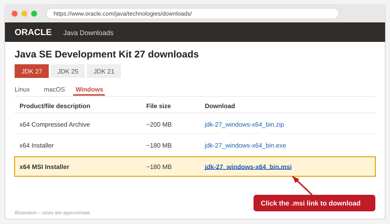

> **Which file should I choose?** Pick the **MSI** file. It installs like any normal Windows program and is easy to uninstall later from *Settings → Apps*. Pick **x64** unless your PC runs Windows on ARM.

### Step 2: Start the installer

1. Open your **Downloads** folder.
2. Double-click **`jdk-27_windows-x64_bin.msi`**.
3. When the Setup Wizard opens, click **Next >**.

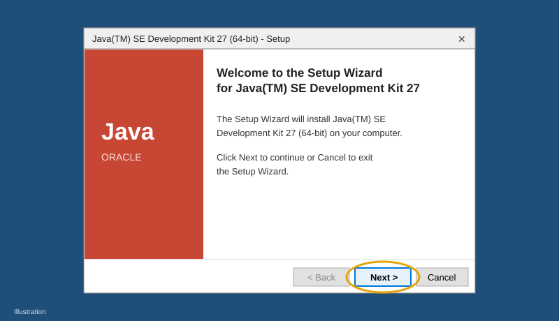

### Step 3: Choose where to install

Leave the default folder as it is:

```
C:\Program Files\Java\jdk-27\
```

Click **Next >**. Write down this path, because you will need it again in Step 6 and in Part 2.

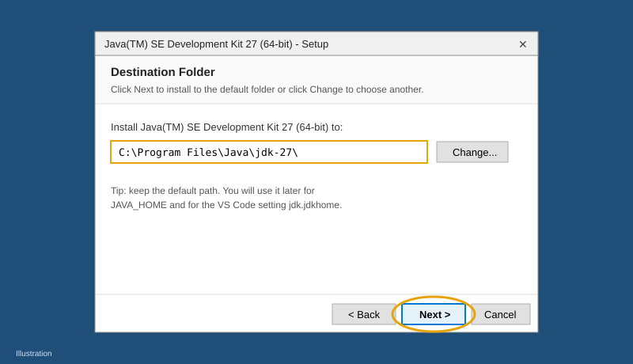

### Step 4: Allow the install

1. Windows asks *"Do you want to allow this app to make changes to your device?"* Click **Yes**.
2. Wait for the progress bar to finish. This takes about a minute.

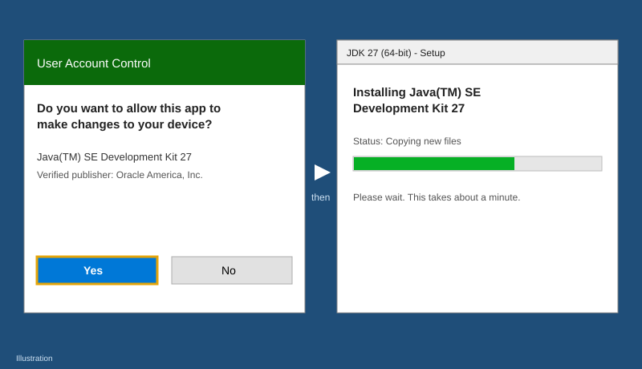

### Step 5: Finish

When you see **"Successfully Installed"**, click **Close**.

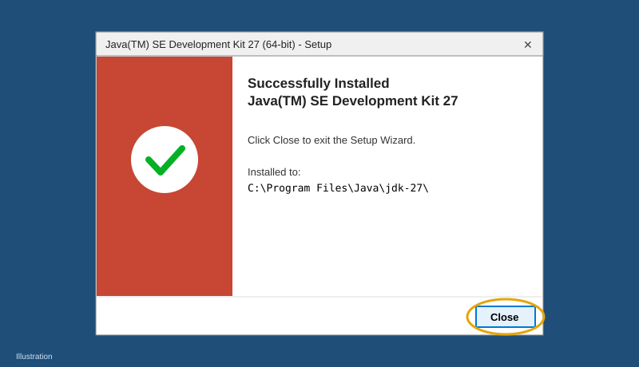

### Step 6: Set `JAVA_HOME` and `Path` (recommended)

The MSI installer usually makes `java` work from the terminal. Many tools still look for `JAVA_HOME`, so it is a good idea to set it yourself:

1. Press **Win** and search for **"Edit the system environment variables"**. Open it.
2. Click **Environment Variables…**.
3. Under **System variables**, click **New…** and enter:
   - Variable name: `JAVA_HOME`
   - Variable value: `C:\Program Files\Java\jdk-27`
4. Under **System variables**, select **Path** and click **Edit…** → **New**. Type `%JAVA_HOME%\bin`, then click **Move Up** until it is at the top of the list.
5. Click **OK** on every window to save.

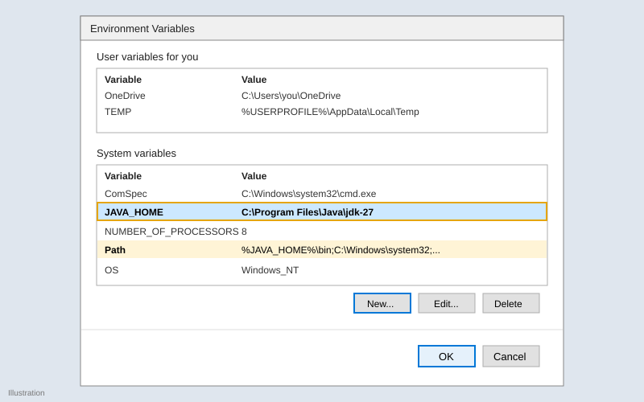

### Step 7: Check that it works

Open a **new** Command Prompt. Windows that were already open will not see the new settings. Run:

```bat
java -version
```

```bat
javac -version
```

```bat
echo %JAVA_HOME%
```

Both `java` and `javac` should show version **27**:

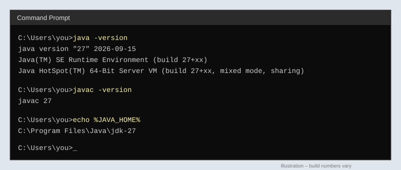

#### Troubleshooting

| Problem | Fix |
|---|---|
| `'java' is not recognized…` | Open a **new** terminal. If it still fails, check Step 6 (the `Path` entry). |
| It shows an **older** Java version | Another JDK comes earlier in `Path`. Move `%JAVA_HOME%\bin` to the top, or remove the old JDK in *Settings → Apps*. |
| `echo %JAVA_HOME%` prints `%JAVA_HOME%` | The variable is not set. Repeat Step 6 and open a new terminal. |

---

## Part 2 – Set up VS Code with the Oracle Java extension

### Step 1: Install VS Code

Download VS Code from <https://code.visualstudio.com/> and run the installer. On the *Select Additional Tasks* screen, it helps to tick **"Add 'Open with Code' action"** and **"Add to PATH"**.

### Step 2: Install the Oracle "Java" extension

1. Open VS Code.
2. Click the **Extensions** icon in the left bar, or press **Ctrl + Shift + X**.
3. Search for **`Oracle Java`**.
4. Choose the extension called **Java**, published by **Oracle**. Its ID is `Oracle.oracle-java`. Click **Install**.

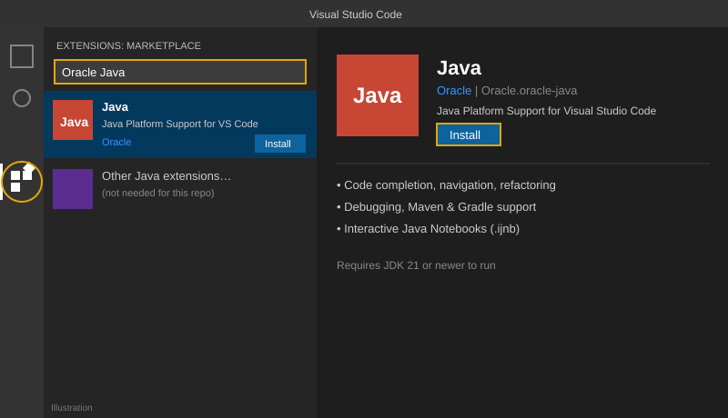

> The extension needs **JDK 21 or newer** to run. JDK 27 from Part 1 meets this.
>
> If you also have other Java extensions installed (for example Red Hat's *Language Support for Java*), you may see duplicate suggestions or errors. If that happens, disable the other extension for this workspace.

### Step 3: Point the extension to JDK 27

1. Open Settings with **Ctrl + ,**.
2. Search for **`jdk.jdkhome`**.
3. Set it to `C:\Program Files\Java\jdk-27`.

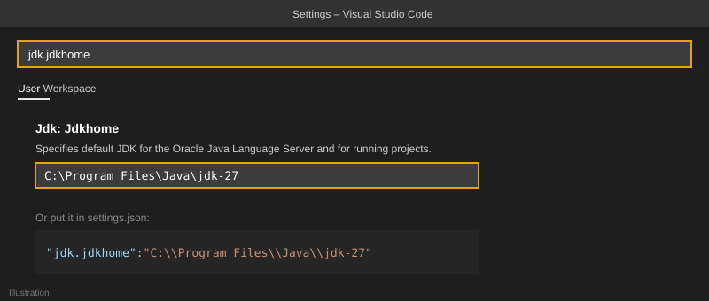

You can also add this line to `settings.json` (open it with *Ctrl + Shift + P → "Preferences: Open User Settings (JSON)"*):

```json
{
  "jdk.jdkhome": "C:\\Program Files\\Java\\jdk-27"
}
```

Restart VS Code after you change this setting.

### Step 4: Open this folder and trust it

1. **File → Open Folder…** and choose this repository folder.
2. When VS Code asks *"Do you trust the authors of the files in this folder?"*, click **Yes, I trust the authors**. The Oracle extension **only works in trusted workspaces**.

---

## Part 3 – Run Java code as a notebook

A Java notebook (`.ijnb`) works like a Jupyter notebook, but for Java:

- The file is a list of **cells**. A cell is either **Markdown** (text) or **Code** (Java).
- You **don't need** `public class Main` or `public static void main(String[] args)`. You write Java statements directly and run them.
- Each cell's **output is saved inside the notebook**, right under the cell.
- Variables you define in one cell can be used in later cells, as long as the kernel keeps running.

### Open an existing notebook

Open any `.ijnb` file in this repo from the Explorer, for example `variables/variable.ijnb`. It opens in the notebook editor.

### Create a new notebook

1. Press **Ctrl + Shift + P** to open the Command Palette.
2. Run **`Java: Create New Notebook...`**.
3. Choose a folder and a file name. The file is saved with the `.ijnb` extension.

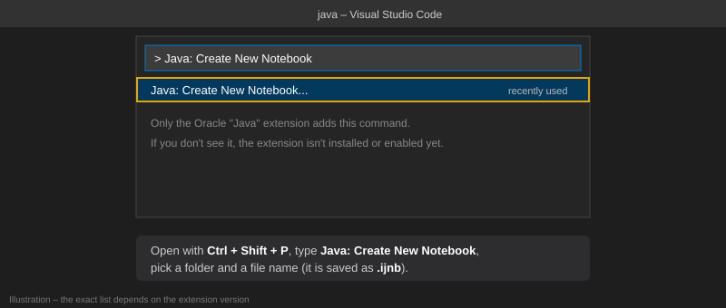

### Write and run cells

| Action | How |
|---|---|
| Add a code cell | Click **+ Code** |
| Add a text cell | Click **+ Markdown** |
| Edit a cell | Double-click it. Press **Esc** when you're done. |
| Run one cell | Click **▶** on the left of the cell, or press **Ctrl + Enter** |
| Run a cell and go to the next one | **Shift + Enter** |
| Run every cell | Click **Run All** in the notebook toolbar |
| Start fresh (clear all variables) | Click **Restart** in the notebook toolbar |

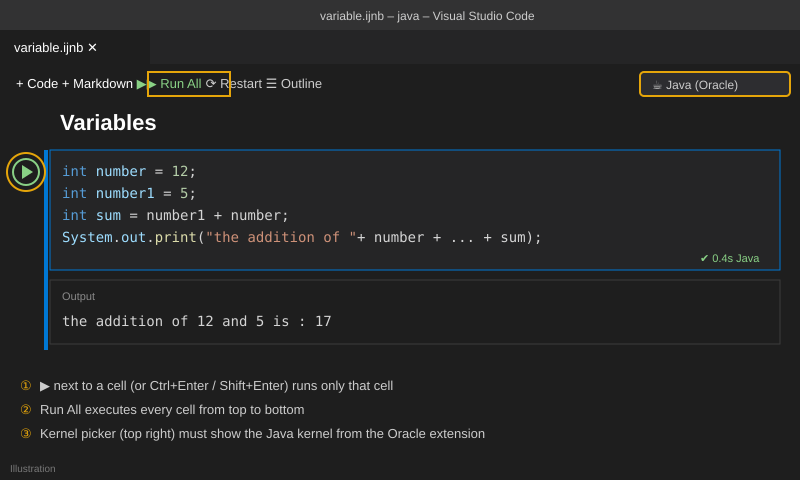

Try this: open `variables/variable.ijnb`, click **Run All**, and compare your results with the saved outputs.

### Notebook tips

- **Running a declaration again is OK.** In a notebook, writing `int a = 42;` in one cell and `int a = 43;` in another cell simply replaces `a`. This works like `jshell`. In a normal `.java` file, declaring the same variable twice in one scope is a compile error.
- **Output order follows run order.** If you run cells out of order, a cell may use values from a different cell than the one just above it. Use **Restart** and then **Run All** to get a clean run.
- **Saved outputs can be out of date.** If you edit code and don't run it again, the old output stays in the file. Run the cell again to refresh it.
- **Kernel not starting?** Make sure the workspace is trusted, `jdk.jdkhome` points to JDK 21 or newer, and the kernel picker in the top-right corner shows the Java kernel.
- **Notebook-specific settings** such as `jdk.notebook.classpath`, `jdk.notebook.enablepreview` and `jdk.notebook.vmOptions` can be changed in Settings. Click **Restart** after changing them.

---

## Repository layout

```
java/
├── README.md                ← this guide
├── assets/                  ← pictures used in this guide
├── variables/
│   ├── README.md
│   └── variable.ijnb
├── Operators/
│   ├── README.md
│   └── Operators.ijnb
└── Conditionals/
    ├── README.md
    └── conditionals.ijnb
```
